# AWS Cloud Security Posture Management (CSPM)

A Python-based cloud security engineering project that audits simulated
Amazon S3 configurations, detects security policy violations, prioritizes
findings, and visualizes security posture through an interactive
Streamlit dashboard.

The project demonstrates security assessment automation, risk-based
triage, IAM configuration, structured reporting, and automated testing.

> **Execution mode:** Offline simulation using local JSON fixtures.
> No live AWS resources are scanned, and no AWS credentials are required.

## Business Problem

Organizations managing large numbers of cloud storage resources need
visibility into security configurations and potential policy violations.

Manual reviews can be time-consuming, inconsistent, and difficult to
scale. Misconfigured access controls, inadequate recovery settings,
and missing monitoring can increase security and operational risk.

This project implements an automated, policy-based assessment workflow
to identify and prioritize S3 configuration findings.

## Architecture

```text
Simulated AWS S3 Configurations
          |
          v
    JSON Fixture Loader
          |
          v
    Input Validation
          |
          v
     S3 Audit Engine
          |
          v
     Security Findings
          |
          v
  Risk Scoring & Prioritization
          |
          v
     JSON Report Generator
          |
          v
    Streamlit Dashboard
          |
          v
 Security Review & Remediation
```

## Technologies

- Python 3
- Amazon Web Services (AWS IAM configuration)
- Amazon S3 security concepts
- Streamlit
- Pandas
- Pytest
- JSON
- Git and GitHub

## Security Controls Assessed

| Security Control | Assessment |
|---|---|
| S3 Block Public Access | Checks all four protection settings |
| Encryption | Evaluates compliance with a custom SSE-KMS policy |
| Versioning | Checks whether versioning is enabled |
| Server Access Logging | Checks whether logging is enabled |

### Important Security Considerations

- Incomplete Block Public Access settings do not necessarily mean
  a bucket is publicly accessible.
- SSE-S3 (AES256) provides encryption at rest. A finding is generated
  because this project's simulated organizational policy requires SSE-KMS.
- Versioning and server access logging requirements depend on
  organizational and operational needs.
- A bucket with no findings is not guaranteed to be secure.
- Risk scores are project-defined weights, not CVSS scores.

## Risk Scoring

The application assigns weighted scores to findings:

| Severity | Weight |
|---|---:|
| CRITICAL | 10 |
| HIGH | 7 |
| MEDIUM | 4 |
| LOW | 1 |

Findings are prioritized by severity, and scores are aggregated to
support security review.

## Demonstration Results

The current simulated environment contains five S3 bucket configurations.

| Metric | Result |
|---|---:|
| Simulated S3 assets scanned | 5 |
| Total findings | 7 |
| Critical findings | 0 |
| High findings | 1 |
| Medium findings | 4 |
| Low findings | 2 |
| Aggregate risk score | 25 |

These results are generated from intentionally designed test fixtures,
not a live AWS environment.

## Dashboard

The Streamlit dashboard provides:

- Security posture metrics
- Severity distribution visualization
- Complete simulated asset inventory
- Severity and bucket filtering
- Finding-specific remediation guidance
- JSON and CSV export capabilities

### Dashboard Overview

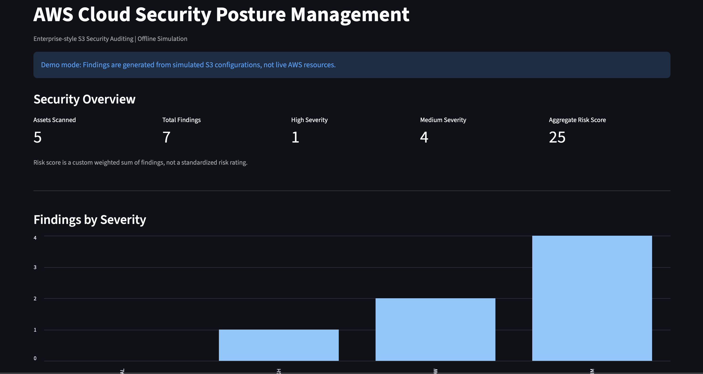

### Asset Inventory

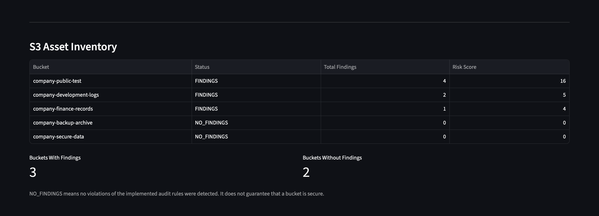

### Security Findings

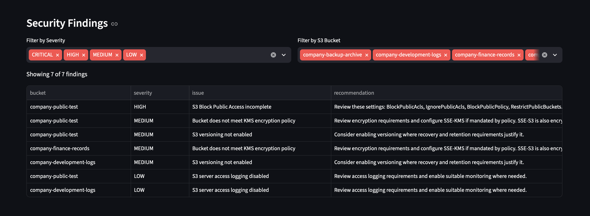

### Remediation Guidance

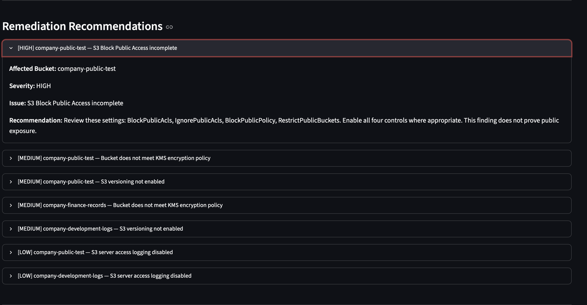

## AWS IAM Security Configuration

A dedicated IAM user and customer-managed S3 security audit policy
were configured in the AWS Console as an independent demonstration
of cloud security administration.

The policy grants S3 configuration inspection permissions without
S3 object modification or deletion actions.

The IAM configuration is not used by the offline scanner.

### IAM Policy

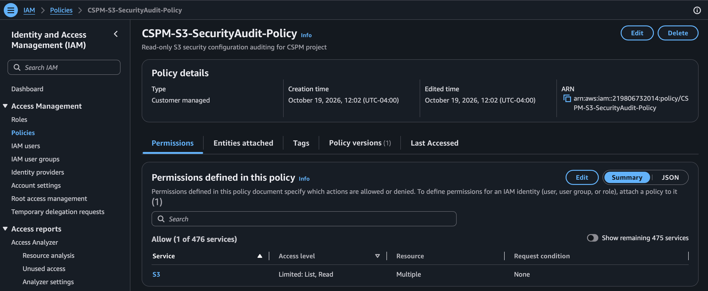

### IAM Scanner User

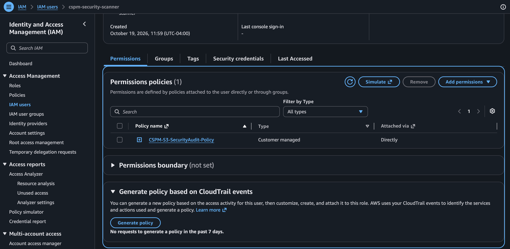

### Policy Permissions

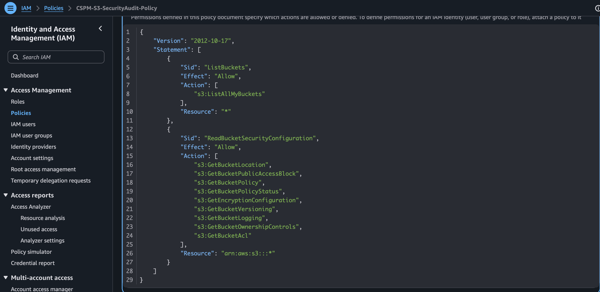

## Cloud Cost Governance

An AWS Budget notification threshold was configured to support
cost monitoring.

AWS Budgets notifications are alerts, not hard spending limits.

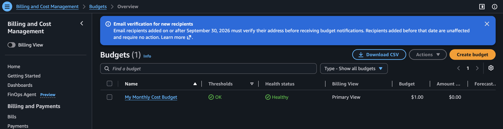

## Scanner Execution

The Python scanner loads and validates simulated S3 configurations,
evaluates security controls, calculates risk scores, and generates
a structured JSON report.

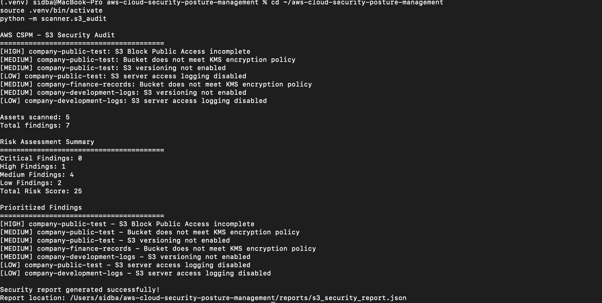

## Automated Testing

The project includes unit and integration tests covering:

- Security detection rules
- Risk scoring and prioritization
- Report generation
- Asset inventory
- Input validation
- Missing configuration fields
- Invalid data types
- Duplicate bucket detection
- Scanner fixture-loading integration

**Latest verified test result: 31 passed.**

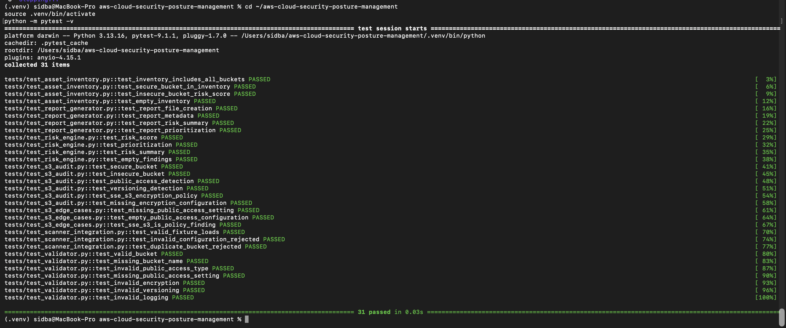

## JSON Security Reporting

Reports include scan metadata, asset inventory, security findings,
risk scores, and prioritized remediation recommendations.

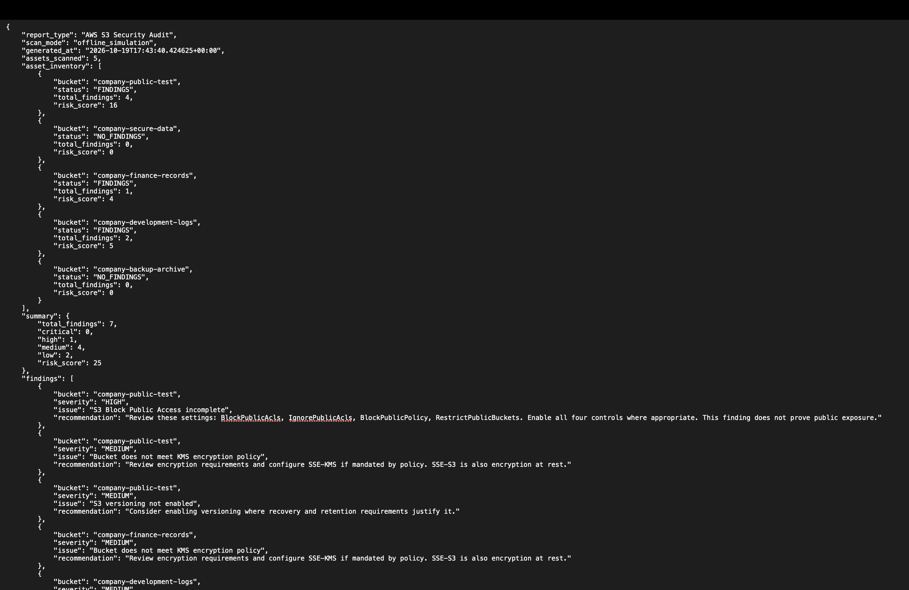

## Project Structure

```text
aws-cloud-security-posture-management/
├── dashboard/
│   └── app.py
├── fixtures/
│   └── s3_buckets.json
├── scanner/
│   ├── s3_audit.py
│   ├── validator.py
│   ├── risk_engine.py
│   └── report_generator.py
├── tests/
├── screenshots/
├── reports/
├── requirements.txt
├── .gitignore
└── README.md
```

## Installation

Clone the repository and enter the project directory:

```bash
git clone https://github.com/YOUR_USERNAME/aws-cloud-security-posture-management.git
cd aws-cloud-security-posture-management
```

Create a Python virtual environment:

```bash
python3 -m venv .venv
source .venv/bin/activate
```

Install dependencies:

```bash
python -m pip install -r requirements.txt
```

## Run the Security Scanner

```bash
python -m scanner.s3_audit
```

The scanner reads local fixture data and generates:

```text
reports/s3_security_report.json
```

## Launch the Dashboard

Generate the report first, then run:

```bash
python -m streamlit run dashboard/app.py
```

Open:

http://localhost:8501

## Run Automated Tests

```bash
python -m pytest -v
```

## Security and Operational Limitations

This is a portfolio and educational security engineering project.

- The current scanner uses simulated S3 configurations.
- It does not make AWS API calls.
- It does not verify actual bucket exposure.
- It does not evaluate all possible S3 security controls.
- IAM permissions were configured separately in AWS.
- The risk model uses custom severity weights.
- Generated reports are excluded from Git tracking.

## Future Improvements

- Optional authenticated, read-only AWS configuration collection
- Expanded S3 security checks
- IAM and CloudTrail posture assessments
- Multi-account reporting
- Policy-as-code integration
- Continuous integration with GitHub Actions

## Disclaimer

All scanner findings are derived from intentionally simulated
configurations. The project does not claim to have audited or
remediated production AWS resources.
